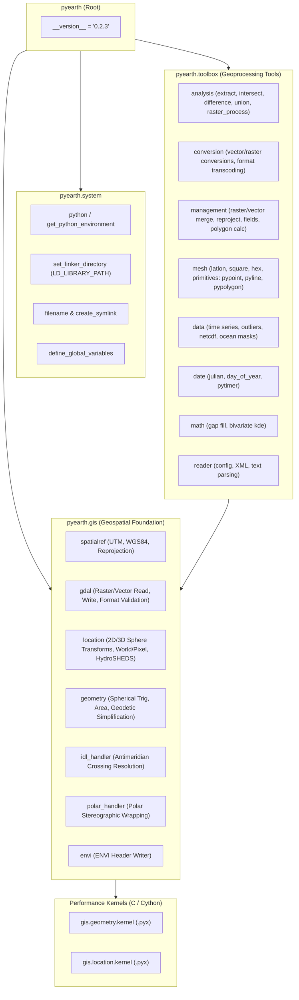

# PyEarth Architecture Reference

`pyearth` (v0.2.3) is a lightweight Python package for Earth science and geospatial computation developed by Dr. Chang Liao (Pacific Northwest National Laboratory / E3SM project).

It serves as the foundational spatial computing and geoprocessing engine within the **PyEarthSuite** ecosystem, deliberately decoupled from visualization packages (`pyearthviz`, `pyearthviz3d`) and graph topology packages (`pyearthriver`).

---

## 1. Architectural Philosophy & Design Principles

PyEarth synthesizes two primary software paradigms:

1. **ArcGIS Geoprocessing Toolbox Paradigm**:
   - Geoprocessing functionality is arranged into clear domain toolboxes: `analysis`, `conversion`, `management`, and `mesh`.
   - Tool operations follow single-responsibility modules named identically to their primary exported functions (e.g. `clip_vector_by_polygon_file.py` exposes `clip_vector_by_polygon_file`).
2. **IDL Coyote Library Paradigm**:
   - Provides dependable, lightweight Earth-science utility routines that run without bloated frameworks or restrictive dependency chains.
3. **Dual Execution Paths (Cython Acceleration with Graceful Fallback)**:
   - High-throughput inner loops (spherical distance, 3D plane intersections, coordinate conversions) are implemented in Cython (`.pyx`) with typed memoryviews and C standard math library calls (`libc.math`).
   - If Cython extensions are uncompiled, modules gracefully fall back to NumPy/pure-Python equivalents.
4. **Strict Hungarian Variable Conventions**:
   - Variables and function parameters follow explicit type and semantic prefixes throughout the codebase:
     - `sFilename_*`: String file paths
     - `dLongitude_*`, `dLatitude_*`: Double-precision float coordinates
     - `aCoordinates_*`, `aCell_*`: Array-like sequences
     - `iFlag_*`: Integer configuration modes/flags
     - `bFlag_*`: Boolean toggles
     - `pSpatialRef_*`, `pLayer_*`, `pDataset_*`: OGR/GDAL native object handles

---

## 2. High-Level Package Architecture



---

## 3. Subsystem Breakdown Down to Module and Function Level

### 3.1 `pyearth.system`
System operations, environment detection, and shared library configuration.

| Submodule / File | Key Classes & Functions | Description |
| :--- | :--- | :--- |
| `filename.py` | `get_extension_from_filename(sFilename)`<br>`get_extension_from_path(sPath)`<br>`get_filename_without_extension(sFilename)`<br>`get_filename_from_path_without_extension(sPath)`<br>`get_folder_path(sPath)` | Robust path extraction and extension parsing without external dependencies. |
| `set_linker_directory.py` | `configure_linker_path(sDirectory_lib)` | Dynamically configures `LD_LIBRARY_PATH` (Linux) / `DYLD_LIBRARY_PATH` (macOS) to ensure native GDAL/GEOS shared libraries resolve correctly at runtime. |
| `create_symlink.py` | `create_symlink(sFilename_source, sFilename_target)` | Safe symbolic link creation with target overwrite verification. |
| `define_global_variables.py` | `define_global_variables()` | Initializes global runtime scratchpaths and projection definitions. |
| `python/get_python_environment.py` | `get_python_environment()`<br>`get_conda_environment()` | Discovers active Python executable, Conda root, and virtual environment details. |

---

### 3.2 `pyearth.gis`
Core spatial engine, GDAL/OGR wrappers, geodetic algorithms, and boundary handlers.

#### 3.2.1 Spatial Reference (`pyearth.gis.spatialref`)
- `utm_utility.py`:
  - `get_utm_zone(dLongitude, dLatitude)`: Computes the 1–60 UTM zone number and North/South hemisphere indicator.
  - `get_utm_epsg_code(dLongitude, dLatitude)`: Calculates EPSG codes (`32601`–`32660` for North, `32701`–`32760` for South).
  - `get_utm_spatial_reference_wkt(dLongitude, dLatitude)`: Generates complete WKT spatial reference strings for UTM zones.
- `reproject_coordinates.py`:
  - `reproject_coordinates(dLongitude, dLatitude, pSpatialRef_in, pSpatialRef_out)`: Reprojects coordinate pairs using `osr.CoordinateTransformation`.
  - `reproject_coordinates_batch(aLongitude, aLatitude, pSpatialRef_in, pSpatialRef_out)`: High-efficiency array coordinate reprojection.
- `convert_between_degree_and_meter.py`:
  - `degree_to_meter(dLatitude)` / `meter_to_degree(dLatitude)`: Local geodetic metric scaling per degree of latitude/longitude.
- `is_wgs84_projection.py`:
  - `is_wgs84_projection(pSpatialRef)`: Validates whether a spatial reference matches standard WGS84 (EPSG 4326).

#### 3.2.2 GDAL / OGR Drivers & I/O (`pyearth.gis.gdal`)
- **Format Inspection & Introspection**:
  - `gdal_raster_format_support.py`: Maps raster file extensions to GDAL driver codes (`GTiff`, `ENVI`, `AAIGrid`, etc.).
  - `gdal_vector_format_support.py`: Maps vector extensions to OGR drivers (`ESRI Shapefile`, `GeoJSON`, `GPKG`), including `check_parquet_support()` / `has_parquet_support()`.
  - `gdal_check_file_type.py`: Determines whether a file path is raster, vector, or invalid.
  - `gdal_check_raster_valid.py`: Validates raster dimensions, band counts, and raster integrity.
  - `gdal_validate_polygon_file.py`: Inspects vector polygons for OGC validity.
  - `gdal_to_numpy_datatype.py`: Bidirectional type mapper between GDAL data type codes (`GDT_Byte`, `GDT_Float32`, etc.) and NumPy dtypes (`np.uint8`, `np.float32`).
- **Raster I/O (`gdal.read.raster` / `gdal.write.raster`)**:
  - `gdal_read_geotiff_file.py` / `gdal_read_envi_file.py`: Reads raster matrices (single and multi-band) along with spatial extents, geotransforms, and projections.
  - `gdal_read_ascii_file.py`: Reads ESRI ASCII Grid formats.
  - `gdal_get_raster_extent.py` / `gdal_get_raster_spatial_reference.py`: Extent and projection header extractors.
  - `gdal_write_geotiff_file.py` / `gdal_write_envi_file.py`: Serializes NumPy arrays to GeoTIFF and ENVI datasets with spatial geotransforms.
- **Vector I/O (`gdal.read.vector` / `gdal.write.vector`)**:
  - `gdal_read_vector_file.py`: Opens vector layers and extracts geometries and attributes.
  - `gdal_get_vector_extent.py` / `gdal_get_vector_boundary.py`: Bounding envelope and polygon boundary extraction.
  - `gdal_export_point_to_vector_file.py`: Exports point lists to Shapefile or GeoJSON.
  - `gdal_write_wkt_to_vector_file.py`: Converts WKT strings directly into vector files on disk.

#### 3.2.3 Coordinate Transformations & Location Utilities (`pyearth.gis.location`)
- `convert_between_longitude_latitude_and_sphere_3d.py`:
  - `convert_longitude_latitude_to_sphere_3d(dLongitude, dLatitude)`: Transforms $(\lambda, \phi)$ to 3D Cartesian coordinates $(x, y, z)$ on a unit sphere.
  - `convert_sphere_3d_to_longitude_latitude(x, y, z)`: Maps Cartesian coordinates back to spherical $(\lambda, \phi)$.
- `get_geometry_coordinates.py`:
  - `get_geometry_coordinates(geom)`: Unified geometric parser extracting vertices across `Point`, `LineString`, `LinearRing`, `Polygon`, and `MultiPolygon`.
- `world2Pixel.py` & `Google_MetersPerPixel.py`:
  - GeoTransform affine coordinate translation to pixel $(X, Y)$ and web map tile zoom level metric scaling.
- `get_hydrosheds_continent_from_extent.py`:
  - `get_hydrosheds_continent_from_extent(dMinX, dMinY, dMaxX, dMaxY)`: Maps bounding boxes to HydroSHEDS continent codes (`af`, `as`, `au`, `ca`, `eu`, `na`, `sa`).

#### 3.2.4 Geodesic Geometry, Antimeridian & Polar Handling (`pyearth.gis.geometry`, `idl_handler`, `polar_handler`)
- `calculate_polygon_area.py`:
  - `calculate_polygon_area(...)`: Great-circle spherical excess / l'Huilier area calculations for spherical polygons.
  - `calculate_polygon_file_area(sFilename)`: Computes aggregate areas across vector files.
- `calculate_distance_based_on_longitude_latitude.py`:
  - Haversine great-circle distance between coordinates.
- `calculate_distance_to_plane.py` / `calculate_distance_to_line.py`:
  - Perpendicular 3D spherical distances between points and great-circle planes or lines.
- `calculate_intersect_on_great_circle.py`:
  - Calculates intersections of great-circle paths on a sphere using vector normal cross-products.
- `douglas_peucker_geodetic.py` / `visvalingam_whyatt_geodetic.py`:
  - Geodetic line and polygon simplification using great-circle distance or spherical triangle effective area (`VWSimplifier` class).
- `check_counter_clockwise.py` / `check_convex_polygon.py`:
  - Ring orientation validation (CCW outer ring / CW inner rings) via spherical shoelace formulas and convexity tests.
- `idl_handler.py`:
  - Classes: `IdlStrategy` (SPLIT, UNWRAP, SHIFT), `IdlResult`, `IdlHandler`.
  - Solves the International Date Line ($\pm 180^\circ$) discontinuity: detects antimeridian crossing edges, unwraps coordinates continuously, or splits single polygons into valid MultiPolygons across $180^\circ$.
- `polar_handler.py`:
  - Classes: `PoleType` (NORTH, SOUTH, BOTH, NONE), `PolarResult`, `PolarHandler`.
  - Detects if polygon rings enclose the North or South Pole, transforming them via polar stereographic projection to prevent spherical singularities.
- `envi/envi_write_header.py`:
  - Writes ENVI `.hdr` metadata files matching raster bands and interleave specs.

---

### 3.3 `pyearth.toolbox`
Geoprocessing workflows structured into standard GIS toolbox categories.

#### 3.3.1 Analysis (`pyearth.toolbox.analysis`)
- **Extraction (`analysis.extract`)**:
  - `clip_vector_by_polygon_file.py`: Clips vector layers by polygon boundaries with field schema preservation.
  - `clip_vector_by_bounding_box.py`: Fast bounding envelope spatial clipping.
  - `clip_raster_by_polygon_file.py`: GDAL Warp/mask raster clipping using vector polygon geometries.
  - `exclude_vector_by_polygon_file.py`: Geometric difference masking (erasing vector features overlapping a polygon).
  - `filter_vector_by_attribute.py`: OGR SQL attribute query filtering.
  - `filter_vector_by_polygon.py`: Spatial containment filtering.
- **Topological Overlay (`analysis.intersect`, `difference`, `union`)**:
  - `intersect_polygon_with_polygon_file.py` / `intersect_polyline_with_polygon_file.py`: Intersects polygons and polylines against boundary files.
  - `difference_polygon_with_polygon_file.py` / `difference_polyline_with_polygon_file.py`: Vector subtraction and erasure.
  - `union_polygon_file.py`: Merges and resolves overlaps across polygons.
- **Raster Enhancement (`analysis.image.raster_process`)**:
  - `create_raster_buffer_zone(...)`: Creates morphological raster buffers.
  - `fix_raster_antimeridian_issue(...)` / `reset_antimeridian_column(...)`: Resolves raster discontinuity at $180^\circ$.

#### 3.3.2 Conversion (`pyearth.toolbox.conversion`)
- `rasterize_vector.py`: High-performance burn of vector shapes into rasters via `gdal.RasterizeLayer`.
- `vectorize_raster.py`: Extracts vector polygons from raster values using `gdal.Polygonize`.
- `convert_vector_format.py`: Converts between Shapefile, GeoJSON, and GeoPackage with automated `ogr2ogr` subprocess acceleration.
- `convert_polygon_to_polyline_file.py`: Converts polygon boundary rings to polyline features.
- `convert_vector_to_global_raster.py`: Rasterizes features onto standardized global grid resolutions ($0.1^\circ$, $0.25^\circ$, $0.5^\circ$).

#### 3.3.3 Management (`pyearth.toolbox.management`)
- **Vector (`management.vector`)**:
  - `merge_features.py`: Merges intersecting geometries using R-tree spatial indexing (`rtree.index.Index`), bounding box overlap filtering, connectivity graph grouping, and cascaded union.
  - `merge_vector_files.py`: Appends multiple vector files into a unified layer.
  - `polygon_calculator.py`: Executes polygon geometric difference using pure OGR, RTree-indexed OGR, or Cython channel pipelines.
  - `remove_small_polygon.py`: Filters out slivers and small polygons below area thresholds.
  - `fields.py`: Vector attribute schema management (`add_field_to_vector_file`, attribute reading).
  - `reproject.py`: Batch vector coordinate reprojection.
- **Raster (`management.raster`)**:
  - `merge_raster_files.py`: Mosaics multiple raster files into a single composite image.
  - `reproject.py`: Raster reprojection using `gdal.ReprojectImage`.
  - `resample.py`: Resamples raster grids to target cell resolutions.

#### 3.3.4 Mesh Generation & Geometric Primitives (`pyearth.toolbox.mesh`)
- **Mesh Data Structures**:
  - `point.py`: `pypoint` class and `PointClassEncoder` (JSON serialization).
  - `line.py`: `pyline` class and `LineClassEncoder`.
  - `polyline.py`: `pypolyline` class and `PolylineClassEncoder`.
  - `polygon.py`: `pypolygon` class and `PolygonClassEncoder`.
  - `circle.py`: `pycircle` class and `CircleClassEncoder`.
  - `nvector.py`: `pynvector` class (geodetic normal vector representation avoiding polar singularities).
- **Mesh Generators**:
  - `latlon/create_latlon_mesh.py`: Builds structured latitude/longitude grids with topology indexing.
  - `square/create_square_mesh.py`: Generates regular square meshes in projected coordinates.
  - `hexaon/create_hexagon_mesh.py`: Generates regular hexagonal tessellations with discrete global grid addressing (supporting HexWatershed).
- **Mesh Algorithms (`mesh.algorithm`)**:
  - `split_by_length.py`: Subdivides polylines using SLERP (Spherical Linear Interpolation).
  - `convert_coordinates.py`: Translates raw GCS/PCS coordinates into structured `meshcell` and `pypolyline` objects.
  - `find_minimal_enclosing_polygon.py` / `save_points_as_polygon.py`: Convex hulls and point-to-polygon exporters.

#### 3.3.5 Earth Science Data, Time, & Math (`pyearth.toolbox.data`, `date`, `math`, `reader`)
- **Data & Time Series**:
  - `convert_time_series_daily_to_monthly.py`: Daily to monthly temporal aggregation for climate datasets.
  - `cgpercentiles.py`: Cumulative percentile curve calculation.
  - `remove_outliers.py`: Statistical outlier removal.
  - `ocean/define_land_ocean_mask.py`: Generates global land/ocean binary vector masks from Natural Earth datasets.
  - `beta/add_variable_to_netcdf.py` / `replace_variable_in_netcdf.py`: In-place NetCDF variable modification.
- **Calendar & Timers (`date`)**:
  - `julian.py`: Julian date conversions (`to_jd`, `from_jd`).
  - `day_of_year.py`, `day_in_month.py`, `leap_year.py`, `dt2cal.py`: Calendar math for climate and hydrologic models.
  - `timer.py`: Performance benchmarking with `pytimer` class and `TimerError`.
- **Math & Statistics (`math`)**:
  - `gap_fill_by_window.py`: Spatial moving-window interpolation and gap-filling.
  - `stat/scipy_bivariate_kde.py`: 2D kernel density estimation using SciPy.
  - `stat/remap.py`: Linear value remapping and scaling.
- **File & Configuration Readers (`reader`)**:
  - `read_configuration_file.py`: JSON/YAML configuration ingestion.
  - `parse_xml_file.py`: General XML parsing.
  - `beta/parse_xml_file_e3sm.py`: Specialized XML parsers for E3SM land (`ELM`) and atmospheric (`EAM`) configuration decks.

---

### 3.4 Hardware & Performance Layer (Cython Extensions)

Cython extensions are defined in `setup.py` and built using `pyproject.toml`:

```
pyearth/
├── gis/
│   ├── geometry/
│   │   ├── kernel.pyx   # Cython source
│   │   └── kernel.c     # Pre-generated C fallback
│   └── location/
│       ├── kernel.pyx   # Cython source
│       └── kernel.c     # Pre-generated C fallback
```

1. **`pyearth.gis.location.kernel`**:
   - `cpdef object convert_longitude_latitude_to_sphere_3d(double dLongitude_in, double dLatitude_in)`:
     - Direct C-level spherical coordinate mapping to 3D unit vectors using `libc.math.sin` and `cos`.
     - Bounds checking disabled (`@cython.boundscheck(False)`) for minimal instruction overhead.
2. **`pyearth.gis.geometry.kernel`**:
   - `cpdef calculate_distance_based_on_longitude_latitude(...)`:
     - Polymorphic entrypoint handling scalars, NumPy arrays, and Python lists.
   - `cpdef cnp.ndarray calculate_distance_based_on_longitude_latitude_array(...)`:
     - High-speed typed memoryview implementation (`double[:]`) iterating without Python GIL overhead.
   - `cpdef calculate_angle_between_vectors_coordinates(...)`:
     - Inner-product angle calculation with clamping to $[-1.0, 1.0]$ preventing domain errors in `acos`.
   - `def calculate_distance_to_plane(...)`:
     - 3D plane coefficients $(A, B, C, D)$ via cross product and normal projection distance calculations.

---

## 4. Key Engineering Idioms

- **Explicit GDAL Memory Cleanup**: Native C++ GDAL/OGR dataset references are explicitly nulled (`pDataset = None`, `pLayer = None`) to prevent memory leaks and release Windows file locks.
- **Index-Accelerated Geometry**: High-cost topological operations in `management.vector` leverage `rtree.index.Index` bounding box spatial indices to filter candidates prior to invoking GEOS intersection checks.
- **JSON Serialization Architecture**: Mesh primitives (`pypoint`, `pyline`, `pypolygon`) provide dedicated `json.JSONEncoder` subclasses to enable clean serialization to GeoJSON-like structured files.
