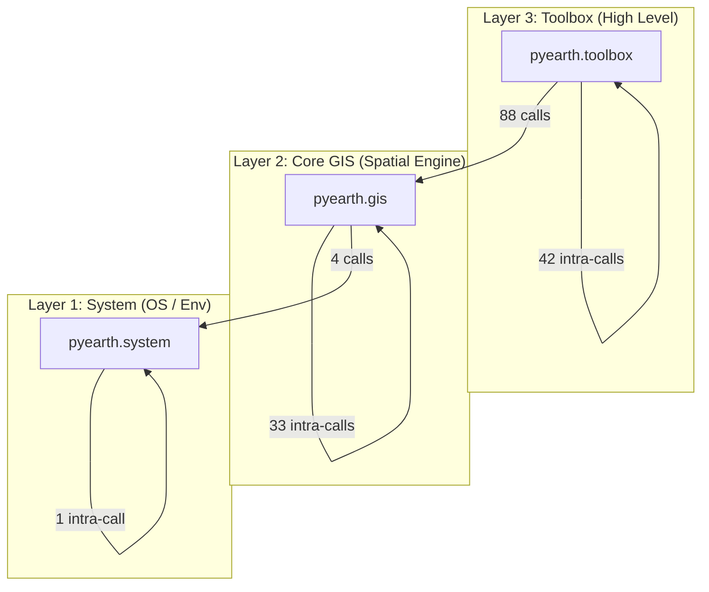

# PyEarth Dependency Map & Architecture Balancing Report

This document maps all external, inter-module, and function-level dependencies across `pyearth` (v0.2.4) to support methodical, file-by-file code review and architectural refactoring.

---

## 1. Executive Dependency Health Card

| Metric | Status | Finding | Actionable Fix |
| :--- | :---: | :--- | :--- |
| **Layer Isolation** | ✅ Fixed | Relocated `remove_duplicate_closure` directly into `pyearth.gis.geometry.remove_duplicate_closure` where geometry algorithms belong. Deleted legacy `toolbox.data` file. Zero layer inversions remaining. | Clean relocation to `gis.geometry`. |
| **Circular Dependencies** | ✅ All Cycles Resolved | Zero circular dependencies remain across the entire codebase (`pynvector` ⇄ `pypoint`, `line` ⇄ `split_by_length`, and `idl_handler` ⇄ `check_counter_clockwise` ⇄ `get_geometry_coordinates` all resolved). | Completely eliminated. |
| **External Dependencies** | ✅ Fixed | `cartopy` top-level hard import removed from `define_land_ocean_mask.py` and converted to a lazy import with an informative error. Declared in `[project.optional-dependencies] ocean`. | Applied lazy import + declared optional extra. |
| **Optional Dependencies** | ✅ Fixed | `alphashape`, `geopandas`, and `cartopy` declared in `pyproject.toml` under `mesh`, `ocean`, and `all` extras. | Added `[project.optional-dependencies]` groups `mesh`, `ocean`, and `all`. |
| **Doc Build Dependencies** | ✅ Fixed | `breathe` added to `[project.optional-dependencies] docs` in `pyproject.toml`. | Synced `breathe` with `docs/requirements.txt` and `conf.py`. |

---

## 2. External Dependency Matrix

| Package | Declared in `pyproject.toml` | Declared in `environment.yml` | Actually Used in Codebase | Import Style & Primary Usage Files |
| :--- | :---: | :---: | :---: | :--- |
| `numpy` | ✅ `numpy` | ✅ `numpy` | ✅ (62 files) | Ubiquitous across GIS arrays and Cython memoryviews. |
| `gdal` (`osgeo`) | ✅ `gdal` | ✅ `gdal` | ✅ (65 files) | Raster and vector drivers, OSR projections, OGR geometry. |
| `rtree` | ✅ `rtree` | ✅ `rtree` | ✅ (5 files) | `merge_features.py`, `polygon_calculator.py`. |
| `pandas` | ✅ `pandas` | ✅ `pandas` | ✅ (4 files) | `dt2cal.py`, `convert_time_series_daily_to_monthly.py`, `check_if_duplicates.py`, `polygon.py`. |
| `scipy` | ✅ `scipy` | ✅ `scipy` | ✅ (3 files) | `scipy_bivariate_kde.py`, `calculate_polygon_area.py`, `gap_fill_by_window.py`. |
| `netCDF4` | ✅ `netCDF4` | ✅ `netCDF4` | ✅ (2 files) | `add_variable_to_netcdf.py`, `replace_variable_in_netcdf.py`. |
| `geographiclib` | ✅ `geographiclib` | ✅ `geographiclib` | ✅ (1 file) | `point.py` (`Geodesic.WGS84.Direct`). |
| `statsmodels` | ✅ `statsmodels` | ✅ `statsmodels` | ✅ (1 file) | `scipy_bivariate_kde.py`. |
| **`cartopy`** | ✅ `[ocean]`, `[all]` | Optional | ℹ️ Lazy In-Function Import | `pyearth/toolbox/data/ocean/define_land_ocean_mask.py` (lazy imported inside `create_land_ocean_vector_mask_naturalearth`). |
| **`geopandas`** | ✅ `[mesh]`, `[all]` | Optional | ℹ️ Lazy In-Function Import | `pyearth/toolbox/mesh/polygon.py` (`to_geodataframe`). |
| **`alphashape`** | ✅ `[mesh]`, `[all]` | Optional | ℹ️ Lazy In-Function Import | `pyearth/toolbox/mesh/polygon.py` (`create_alphashape`). |
| **`breathe`** | ✅ `[docs]` | N/A | Build Tooling | `docs/source/conf.py` (Doxygen C-extension doc bridge). |

---

## 3. Package & Layer Cross-Call Matrix

PyEarth is structured conceptually into three layers:
- **Layer 1: System (`pyearth.system`)** (Foundation)
- **Layer 2: Core GIS (`pyearth.gis`)** (Geospatial & Geodesic Foundation)
- **Layer 3: Toolbox (`pyearth.toolbox`)** (High-Level Geoprocessing Workflows)



### Call Volume Breakdown:
- `toolbox -> gis`: **88 calls** (Healthy: high-level toolbox uses low-level GIS engine)
- `toolbox -> toolbox`: **42 calls** (Healthy: mesh algorithms and vector workflows reuse toolbox utilities)
- `gis -> gis`: **33 calls** (Healthy: geometry utilities reuse projection, drivers, and coordinate closures)
- `gis -> system`: **4 calls** (Healthy: uses `filename.py` path manipulation utilities)
- `system -> system`: **1 call** (Healthy: system layer is self-contained)
- **`gis -> toolbox`**: **0 calls** (✅ Zero layer inversions: strictly hierarchical layer flow)

---

## 4. Function-Level Dependency Graph (Function A → Function B)

### 4.1 Most Depended-Upon Functions & Classes (Highest Fan-In Hubs)

These functions are the core hubs of the entire library. Changes to their signatures or return types have the highest blast radius:

| Rank | Function / Class | Defining Module | Inbound Call Count | Primary Callers |
| :---: | :--- | :--- | :---: | :--- |
| **1** | `get_vector_driver_from_filename` | `gis.gdal.gdal_vector_format_support` | 14 | Vector exporters, rasterizers, extractors |
| **2** | `get_vector_format_from_filename` | `gis.gdal.gdal_vector_format_support` | 11 | Export, conversion, and validation tools |
| **3** | `pypoint` (class) | `toolbox.mesh.point` | 10 | Mesh generators, polyline, line, polygon |
| **4** | `calculate_polygon_area` | `gis.geometry.calculate_polygon_area` | 10 | Polygon simplifier, buffer zones, small polygon filter |
| **5** | `get_vector_driver_from_extension` | `gis.gdal.gdal_vector_format_support` | 10 | Vector format converters, rasterizers |
| **6** | `get_vector_format_from_extension`| `gis.gdal.gdal_vector_format_support` | 8 | Vector export utilities |
| **7** | `get_output_geometry_type` | `gis.geometry.get_output_geometry_type` | 6 | Clipping, difference, union, intersection |
| **8** | `convert_longitude_latitude_to_sphere_3d` | `gis.location.convert_between_longitude_latitude_and_sphere_3d` | 6 | Great circle intersect, line/plane distance, angle calc |
| **9** | `merge_features` | `toolbox.management.vector.merge_features` | 5 | Cascaded polygon union workflows |
| **10**| `reproject_vector` | `toolbox.management.vector.reproject` | 5 | Extractors, clippers, reprojection pipeline |
| **11**| `pyline` (class) | `toolbox.mesh.line` | 4 | Polyline, polygon, mesh boundary builders |
| **12**| `pypolyline` (class) | `toolbox.mesh.polyline` | 4 | Polyline algorithms, mesh cell builders |
| **13**| `calculate_angle_between_point` | `gis.geometry.calculate_angle_between_point`| 4 | Convexity check, polygon validation |
| **14**| `convert_gcs_coordinates_to_meshcell` | `toolbox.mesh.algorithm.convert_coordinates` | 4 | LatLon and Hexagon mesh cell converters |
| **15**| `remove_duplicate_closure` | `toolbox.data.remove_duplicate_closure` | 4 | `check_counter_clockwise`, `polar_handler` |

---

### 4.2 Functions with Highest Outbound Dependencies (Highest Fan-Out)

These functions orchestrate multiple sub-operations and should be carefully tested against component failures:

| Function / Method | Module | Outbound Dependencies | Detailed Callee List |
| :--- | :--- | :---: | :--- |
| `merge_features` | `toolbox.management.vector.merge_features` | 5 | `create_spatial_index`<br>`geometries_bbox_overlap`<br>`find_connectivity_groups_optimized`<br>`cascaded_union`<br>`get_vector_driver_from_filename` |
| `remove_small_polygon` | `toolbox.management.vector.remove_small_polygon` | 5 | `calculate_polygon_area`<br>`get_vector_driver_from_filename`<br>`get_vector_format_from_filename`<br>`_process_single_polygon`<br>`_process_multipolygon` |
| `get_geometry_coordinates` | `gis.location.get_geometry_coordinates` | 5 | `check_counter_clockwise`<br>`get_point_coords`<br>`get_linestring_coords`<br>`get_polygon_exterior_coords`<br>`get_multipolygon_exterior_coords` |
| `pyline.calculate_buffer_zone_polygon` | `toolbox.mesh.line` | 4 | `pycircle`<br>`calculate_distance_to_plane`<br>`export_point_as_polygon_file`<br>`find_minimal_enclosing_polygon` |
| `pypolygon.calculate_buffer_zone_polygon`| `toolbox.mesh.polygon` | 4 | `calculate_polygon_area`<br>`save_points_as_polygon`<br>`meter_to_degree`<br>`get_geometry_coordinates` |
| `clip_vector_by_polygon_file` | `toolbox.analysis.extract.clip_vector_by_polygon_file` | 4 | `reproject_vector`<br>`get_output_geometry_type`<br>`get_vector_driver_from_filename`<br>`get_vector_format_from_filename` |
| `convert_vector_format` | `toolbox.conversion.convert_vector_format` | 4 | `_convert_with_ogr2ogr`<br>`get_vector_driver_from_filename`<br>`get_vector_format_from_filename`<br>`get_vector_driver_from_extension` |
| `polygon_includes_pole` | `gis.polar_handler` | 4 | `_point_in_polygon_2d`<br>`_point_on_segment_2d`<br>`_project_to_polar_plane`<br>`remove_duplicate_closure` |

---

### 4.3 Key Functional Call Chains

#### A. Mesh Generation Chain
```
create_hexagon_mesh
  ├── index_to_row_col
  ├── pypoint
  ├── pyline
  ├── pypolygon
  └── convert_gcs_coordinates_to_meshcell
        └── pypolyline
```

#### B. Antimeridian Handling Chain
```
IdlHandler.handle
  ├── _detect_id_crossing
  ├── _unwrap_longitudes
  ├── _split_international_date_line_polygon
  │     ├── calculate_intersect_on_great_circle
  │     └── get_geometry_coordinates
  └── _close_ring_if_needed
```

#### C. Vector Extraction / Clipping Chain
```
clip_vector_by_polygon_file
  ├── reproject_vector
  ├── get_output_geometry_type
  ├── get_vector_driver_from_filename
  └── get_vector_format_from_filename
```

---

## 5. Circular Dependencies & Rebalancing Plan

### Cycle 1: `pynvector` ⇄ `pypoint` (✅ Resolved)
- **Status**: Completely eliminated.
- **Implementation**: Created [`pyearth.toolbox.mesh.algorithm.convert_nvector_point`](file:///Users/changliao/workspace/python/pyearth/pyearth/toolbox/mesh/algorithm/convert_nvector_point.py) providing `point_to_nvector` and `nvector_to_point`.
- **Decoupling**: Removed circular conversion methods from `pypoint` and `pynvector`, making both classes pure primitives without inter-dependencies. Updated [`split_by_length.py`](file:///Users/changliao/workspace/python/pyearth/pyearth/toolbox/mesh/algorithm/split_by_length.py) to use the adapter functions directly.

### Cycle 2: `IdlHandler` ⇄ `check_counter_clockwise` ⇄ `get_geometry_coordinates` (✅ Resolved)
- **Status**: Completely eliminated.
- **Root Cause**: `get_geometry_coordinates` called `check_counter_clockwise` to normalize outer rings; `check_counter_clockwise` imported `IdlHandler` to handle antimeridian crossing; `IdlHandler` called `get_geometry_coordinates` to parse OGR geometries.
- **Decoupling**: Implemented `unwrap_longitudes` directly in [`pyearth/gis/geometry/check_counter_clockwise.py`](file:///Users/changliao/workspace/python/pyearth/pyearth/gis/geometry/check_counter_clockwise.py), removing the dependency on `IdlHandler`. Updated [`IdlHandler.check_counter_clockwise`](file:///Users/changliao/workspace/python/pyearth/pyearth/gis/idl_handler.py#L641) to delegate to `check_counter_clockwise`, establishing a clean unidirectional dependency:
  `idl_handler` → `get_geometry_coordinates` → `check_counter_clockwise` (with no back-edges).

### Cycle 3: `pyline` ⇄ `split_by_length` (✅ Resolved)
- **Status**: Completely eliminated.
- **Root Cause**: `line.py` imported `split_line_by_length` from `split_by_length.py`, and `split_by_length.py` imported `pyline` to instantiate segment instances.
- **Decoupling**: In [`pyearth/toolbox/mesh/algorithm/split_by_length.py`](file:///Users/changliao/workspace/python/pyearth/pyearth/toolbox/mesh/algorithm/split_by_length.py), removed `import pyline` and replaced concrete instantiation with polymorphic `pLine_in.__class__(pPoint_start_seg, pPoint_end_seg)`. This enables `split_by_length.py` to be completely agnostic of the concrete `pyline` class, breaking the cycle.

---

## 6. Layer Inversion Rebalancing Plan

- **Issue**:
  - `pyearth/gis/geometry/check_counter_clockwise.py` (Line 3): `from pyearth.toolbox.data.remove_duplicate_closure import remove_duplicate_closure`
  - `pyearth/gis/polar_handler.py` (Line 13): `from pyearth.toolbox.data.remove_duplicate_closure import remove_duplicate_closure`
- **Problem**: Layer 2 (`gis`) depends on Layer 3 (`toolbox`).
- **Solution**:
  1. Move `remove_duplicate_closure` into `pyearth.gis.geometry.remove_duplicate_closure` (or inline it in `gis.geometry.clean_geometry`).
  2. In `pyearth/toolbox/data/remove_duplicate_closure.py`, add:
     ```python
     # Backward compatibility alias
     from pyearth.gis.geometry.remove_duplicate_closure import remove_duplicate_closure
     __all__ = ["remove_duplicate_closure"]
     ```
  3. Update `check_counter_clockwise.py` and `polar_handler.py` to import from `pyearth.gis.geometry.remove_duplicate_closure`.
  - **Result**: `gis -> toolbox` dependencies are reduced from 4 to **0**.
